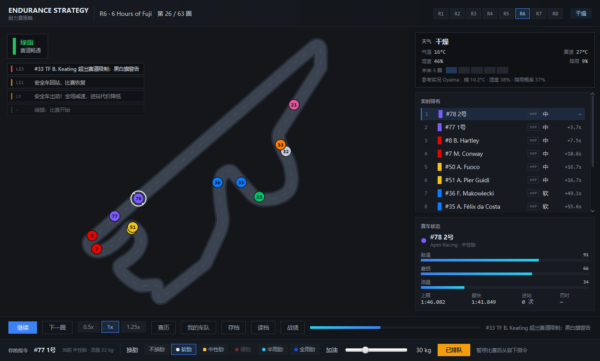
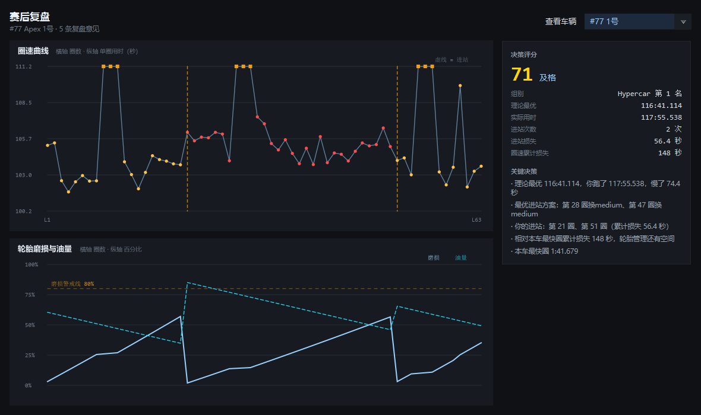
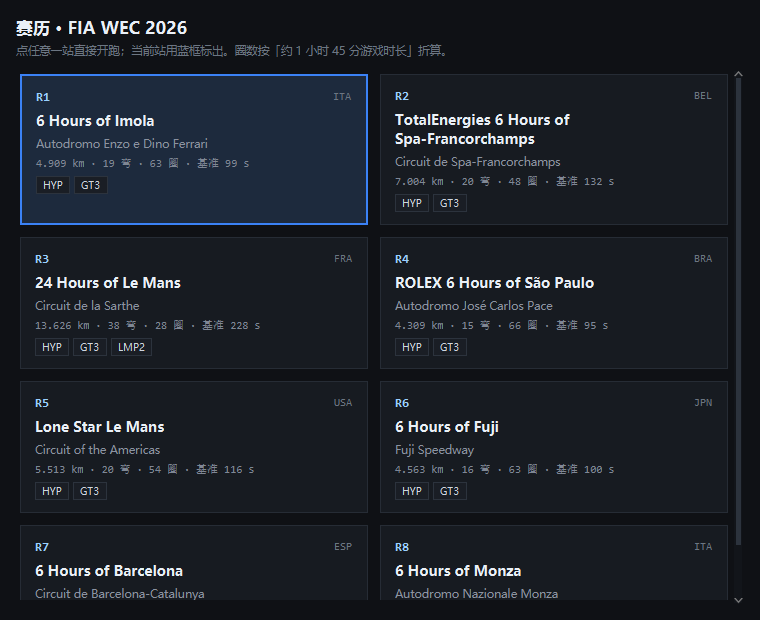
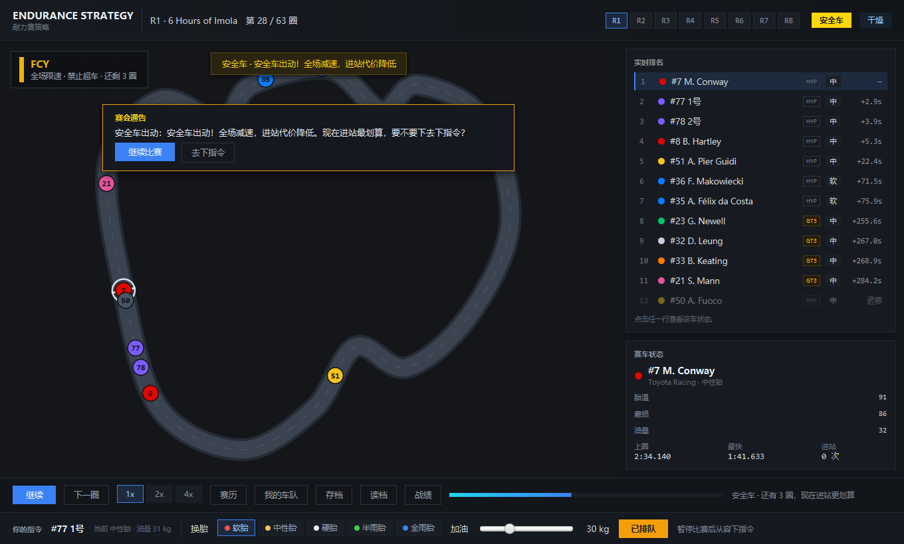
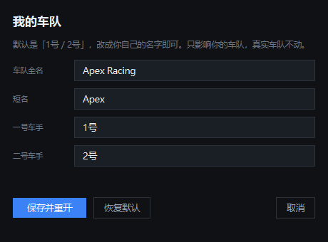
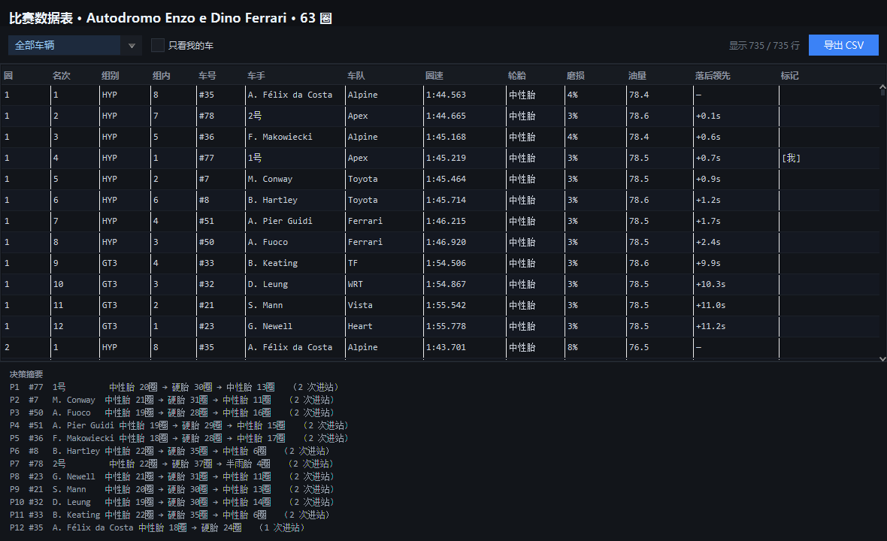

# Endurance Strategy · 耐力赛策略

一个用 **Java 17** 从零实现的**赛车策略博弈**游戏：你不是车手，是车队策略师。

比赛跑的是决策——什么时候进站、换什么胎、加多少油、赌不赌那场雨。
所有仿真、AI、界面、联机协议都是本项目自己写的代码，除 JavaFX 外不依赖任何第三方库。

> **当前状态：功能完整，可直接交付。**
> `test.bat` 一键跑 **172 项自测**，`package.bat` 一键打可分发包。
> 完整规则见 [RULES.md](RULES.md)。




## 目录

1. [快速开始](#快速开始)
2. [操作速查](#操作速查)
3. [怎么玩](#怎么玩)
4. [分站日历](#分站日历)
5. [真实赛道走线（已内置 8 条）](#真实赛道走线已内置-8-条)
6. [官方赛历（2026）](#官方赛历2026)
7. [双组同场（Hypercar + LMGT3）](#双组同场hypercar--lmgt3)
8. [天气面板](#天气面板)
9. [旗语与赛会通告](#旗语与赛会通告)
10. [判罚](#判罚)
11. [我的车队（可改名）](#我的车队可改名)
12. [界面](#界面)
13. [AI 对手](#AI-对手)
14. [复盘与存档](#复盘与存档)
15. [比赛数据表](#比赛数据表)
16. [联机对战（原型）](#联机对战原型)
17. [仿真模型](#仿真模型)
18. [轮胎配方](#轮胎配方)
19. [真实赛事数据校准](#真实赛事数据校准)
20. [数据配置（data/）](#数据配置data)
21. [平衡标定](#平衡标定)
22. [构建与打包](#构建与打包)
23. [目录结构](#目录结构)
24. [设计要点](#设计要点)
25. [已知限制](#已知限制)
26. [交付清单](#交付清单)
27. [路线图](#路线图)
28. [参考资源](#参考资源)

完整规则见 [RULES.md](RULES.md)。

## 快速开始

**环境要求**：Windows + JDK 17（JavaFX 21 的 jar 已经放在 `lib/` 里，不用另外装）

```bat
build.bat                        :: 编译
run.bat                          :: 打开图形界面，自动开赛（推荐）
test.bat                         :: 一键跑完全部自测（172 项断言）
package.bat                      :: 打包成可分发的文件夹 + zip

race-cli.bat list                :: 命令行版：列出赛道 / 车队 / 轮胎
race-cli.bat                     :: 命令行版：跑一场并打印完整报告
race-cli.bat 60 7 monza          :: 圈数 / 随机种子 / 赛道 id

server.bat                       :: 联机服务器（端口 7777、20 圈）
client.bat                       :: 联机客户端，连本机服务器
```

如果你的 JDK 不在 `C:\Program Files\Microsoft\jdk-17.0.15.6-hotspot`，
请编辑 `build.bat` / `run.bat` 顶部的 `JDK` 变量；设置了 `JAVA_HOME` 会自动使用它。


## 操作速查

| 想做什么 | 怎么操作 |
| --- | --- |
| 开始 / 暂停比赛 | 左下角「暂停」「继续」，或空格式的「下一圈」逐圈手动推进 |
| 调整播放速度 | 0.5x / 1x / 1.25x（只影响播放速度，仿真精度不变） |
| 跳过暖胎圈 | 暖胎圈面板上的「跳过暖胎圈」按钮 |
| 只加油不换胎 | 指令条选「不换胎」——省 2.8 秒换胎耗时，但旧胎磨损继续累积 |
| 下进站指令 | 底部指令条选轮胎 → 拖加油量 → 点「本圈进站」，下一圈生效 |
| 查看某台车 | 点击右侧排名里任意一行，车况面板会切到那台车 |
| 看复盘 | 冲线后点结算面板里的「查看复盘」 |
| 存档 / 读档 | 控制条上的「存档」「读档」，文件在 `saves/race.json` |
| 看历史战绩 | 控制条上的「战绩」，数据在 `saves/history.json` |
| 改车队/车手名字 | 控制条「我的车队」，默认是「1号 / 2号」，保存后自动重开一场 |
| 换分站 | 顶部 R1~R8 直接点，或控制条「赛历」打开完整赛历挑一站 |
| 出错了怎么办 | 看 `logs/app.log`，里面有时间戳和完整堆栈 |


## 怎么玩

1. `run.bat` 启动，你是 **#77 Apex 陈奕舟** 的车队策略师，其余七台车是真实 WEC 车队的 AI
2. 进游戏先是**暖胎圈**，看清局面后点「跳过暖胎圈」发车；1x 下一圈约 17 秒
3. 暂停后，底部指令条挑轮胎、拖加油量、点 **本圈进站** → 显示"已排队"，下一圈生效
4. 安全车出动时全场减速、**进站代价只剩 35%**，是最划算的进站窗口
5. 冲线后弹出结算面板，显示前六名和你的名次，可以**再来一场**

**注意**：你不出手，车就会一直跑下去直到燃油耗尽退赛——油量低于 15kg 时状态栏会红字提醒。


## 分站日历

顶部有一排 `R1 ~ R8` 按钮，点哪个就跑哪一站，当前站会变成蓝框并置灰。
控制条的「赛历」按钮打开完整赛历：



每张卡片显示：轮次、国家、分站正式名称、赛道名、长度 / 弯数 / 圈数 / 基准圈速，以及**这一站设哪些组**。
点任意一张卡片直接开跑，比赛会按新赛道的参数重开一场（赛道形状、圈数、油耗、磨损倍率全部跟着换）。

## 真实赛道走线（已内置 8 条）

8 条赛道现在都用**官方矢量图**：`data/tracks/*.svg` 从 Wikimedia Commons 下载，`SvgTracks` 解析出赛道中心线，车沿真实走线行驶。

```
data/tracks/imola.svg      → R1 伊莫拉
data/tracks/spa.svg        → R2 斯帕
data/tracks/lemans.svg     → R3 勒芒
data/tracks/saopaulo.svg   → R4 因特拉戈斯
data/tracks/cota.svg       → R5 COTA
data/tracks/fuji.svg       → R6 富士
data/tracks/barcelona.svg  → R7 巴塞罗那
data/tracks/monza.svg      → R8 蒙扎
```

解析器支持 `<path d="...">` 的全套命令（M/L/H/V/C/S/Q/T/A/Z），会自动挑「点多且占画面大」的那条 path 当赛道外圈，
自动等比缩放居中，直接把这条真实走线当成赛道——**画出来的就是官方原图的形状，
而且车的坐标也是沿这条真实路径算的**。

为什么必须是 SVG 而不是图片：贴一张 PNG 是没用的，车的位置要沿路径算坐标，
位图给不出路径。所以只有矢量图能同时满足"看起来是真的"和"车能正确移动"。

替换或新增任意赛道图：把 SVG 改名成 `<赛道id>.svg` 丢进 `data/tracks/` 即可；没有文件就自动退回内置手绘形状。
调试命令：`java -cp out/classes com.endurance.dev.TrackCheck`。

### 速度剖面

光有正确形状还不够——如果车按路径长度匀速移动，直道和弯道看起来一样快，整圈就像一颗珠子在轨道上滑。

`TrackPath` 沿路径算出每一点的曲率，给弯道段乘上更大的"耗时"，再把一圈的播放时间按耗时比例分配：

```
同一段时间里，直道跑过一大段，弯道只挪一点点
实测：直道速度约为弯道的 2.4 倍
```

它同时解决了另一个问题——位置查询改成"按时间查表"，一圈结束时的位置是连续的，
不会出现跨圈跳变（`test.bat` 里有断言守着）。

## 官方赛历（2026）

赛道数据全部按 [FIA WEC 2026 官方赛历](https://www.fiawec.com/en/season/2026) 来：

| 轮次 | 分站 | 赛道 | 长度 | 弯数 | 基准圈速 | 圈数 |
| --- | --- | --- | --- | --- | --- | --- |
| R1 | 6 Hours of Imola | 伊莫拉 | 4.909 km | 19 | 99.0 s | 63 |
| R2 | 6 Hours of Spa-Francorchamps | 斯帕 | 7.004 km | 20 | 132.0 s | 48 |
| R3 | 24 Hours of Le Mans | 萨尔特 | 13.626 km | 38 | 228.0 s | 28 |
| R4 | 6 Hours of São Paulo | 因特拉戈斯 | 4.309 km | 15 | 95.0 s | 66 |
| R5 | Lone Star Le Mans | COTA | 5.513 km | 20 | 116.0 s | 54 |
| R6 | 6 Hours of Fuji | 富士 | 4.563 km | 16 | 100.0 s | 63 |
| R7 | 6 Hours of Barcelona | 加泰罗尼亚 | 4.657 km | 14 | 101.0 s | 62 |
| R8 | 6 Hours of Monza | 蒙扎 | 5.793 km | 11 | 102.0 s | 62 |

两条换算规则（都写在 `tracks.json` 的 `note` 里）：

- **基准圈速 = 官方 Hypercar 最快圈 × 1.10**：游戏里的一圈要能在几十秒内看完，所以整体放慢约 10%，但**赛道之间的相对快慢保持真实**
- **圈数 = 完整比赛折算成约 1 小时 45 分的游戏时长**：勒芒一圈 228 秒，所以只跑 28 圈；伊莫拉一圈 99 秒，就跑 63 圈

组别也按官方：2026 赛季每站都是 **Hypercar + LMGT3** 同场；勒芒站额外加上 LMP2。

## 双组同场（Hypercar + LMGT3）

按官方组别，比赛里同时跑两组车，**总排名按圈速排、组内另算名次**。

| 组别 | 车队（真实） | 车号 | 特点 |
| --- | --- | --- | --- |
| Hypercar | Toyota Racing / Alpine / Ferrari AF Corse / Apex（玩家） | 7,8 / 35,36 / 50,51 / 77,78 | 基准速度，圈速 1:40 上下 |
| LMGT3 | Heart of Racing / Team WRT / TF Sport / Vista AF Corse | 23 / 32 / 33 / 21 | 每圈慢约 10 秒，总排名被拉开 500 秒以上 |

GT3 的车队、车号、车手全部来自[官方参赛名单](https://www.fiawec.com/en/page/grid)：
Heart of Racing（Aston Martin Vantage）、Team WRT（BMW M4）、TF Sport（Corvette Z06）、Vista AF Corse（Ferrari 296）。

界面里每行名次都带组别标签：`HYP` 灰、`GT3` 琥珀。数据表和复盘也都有组别名次列。

## 天气面板

右侧边栏顶部是一块独立的天气卡（类似《勒芒终极版》的天气面板）：


显示**当前天气、气温、赛道温度、湿度、未来 5 圈降雨概率**，还有一行抓取到的实况参考。

> 最早这块是浮在赛道右下角的，但赛道上四角都有车经过，无论放哪儿都会挡住几台车。
> 挪进侧边栏之后画布彻底干净，12 台车全都能看见。

数据来源：`data/weather.json` 由 [Open-Meteo](https://api.open-meteo.com/) 按 8 条赛道坐标实时抓取（免费、无需 key），
存了抓取时刻的气温 / 湿度 / 降雨概率 / 天气描述。

> 抓取的是 **11 月的实况**，而真实赛历在春夏季，所以比赛里的气温仍由赛道参数决定，
> 只有"降雨概率"会参考那份实况——**常下雨的赛道真的更容易下雨**。

天气突变（干燥↔湿↔雨）现在也算**重大事件**：弹横幅 + 自动降到 0.25 倍速。

## 旗语与赛会通告

按 FIA WEC 运动规则做了旗语系统，指示牌固定在**左上角**：



| 旗语 | 触发条件 | 含义 |
| --- | --- | --- |
| 绿旗 | 默认状态 | 赛道畅通 |
| 黄旗 | 发生撞车（2 圈） | 禁止超车 |
| FCY | 安全车出动期间 | 全场限速，禁止超车 |
| 红旗 | 严重撞车（25% 概率） | 比赛中止，车辆原地不动 2 圈 |
| 格子旗 | 冲线 | 比赛结束 |

另外 `双黄旗 / 蓝旗 / 白旗 / 黑橙旗` 已在枚举里定义好，接数据即可用。

**赛事播报条**：旗语牌下面紧跟着最近 4 条播报（安全车、判罚、进站、退赛），
安全车琥珀色、判罚红色、进站蓝色，最新一条高亮、旧的逐级变淡。
原来事件只在底部状态栏闪一行小字，跑起来根本来不及看。

**赛会通告横幅**：安全车、撞车、红旗这类重大事件弹出横幅时，**游戏速度自动降到 0.25 倍**，
给「继续比赛」和「去下指令」两个按钮——看完、决定完再恢复原速度，不会在你去倒水的两秒钟里错过进站窗口。

### 安全车会真的抹平差距

这是安全车最大的战术价值：前车必须减速等车队集结，后车就能贴上去。

```
每圈把落后差距压掉 35%
实测：87 秒的差距跑完三圈安全车后只剩 35 秒
```

原理上跟真实一致——安全车速度低于赛车，后车不需要跑更快也能保持距离，
于是时间差被"冻住"，物理距离被缩短。这也是为什么安全车窗口是进站的最佳时机。

> 早期版本只做了"全场圈速 ×1.55"，差距一点没变，等于白出安全车。
> 补上压缩之后又冒出个连带问题：复盘时优化器算的"理论最优"不知道时间被压缩过，
> GT3 一度显示「实际 3392 秒 / 最优 3508 秒」。后来加了 `safetyCarCredit` 记账，
> 复盘时把被抹掉的秒数加回实际用时再比较才对上。

## 判罚

按 FIA WEC 运动规则做了两条（都是可验证的、有实际后果的）：

| 违规 | 判定 | 处罚 |
| --- | --- | --- |
| 超出赛道限制 | 每圈按「激进度 + 磨损」算概率 | 第 1 次黑白旗警告 → 第 2 次罚时 5 秒 → 之后 10 秒 |
| 黄旗期间超车 | 局部黄旗圈里名次上升且没进站 | 罚时 5 秒 |

判罚会写进事件流（`[判罚]` 标签），罚时直接计入总时间，车况面板里能看到「罚时 +5s」。

> **踩过的坑**：一开始把安全车期间的名次互换也当成超车，一圈判了 4 台车 5 秒。
> FCY 下全场同速，名次互换只是圈速噪声——所以只在**局部黄旗**（撞车引发的黄旗）时才判定。

## 我的车队（可改名）

控制条上的「我的车队」可以改三样东西：车队全名、短名、两位车手的名字。



- **默认就是「1号 / 2号」**——组里谁用就换成谁的名字，不用改代码
- 只改玩家自己的车队，Toyota / Alpine / Ferrari 这些真实车队不动
- 存在 `saves/player.json`，和 `data/` 下的官方数据分开，升级配置也不会把你的名字冲掉
- 保存后自动重开一场，立刻能在排名里看到新名字


## 界面

主界面分四块：

```
┌──────────────────────────────────────────────────────────────┐
│ ENDURANCE STRATEGY │ R6 · 6 Hours of Fuji · 第 26/63 圈 · 干燥  │
├──────────────────────────────────────────┬───────────────────┤
│                                          │  实时排名          │
│          赛道俯视图（JavaFX Canvas）        │  1 #1 周子墨  —    │
│          小车按车队色 + 车号沿赛道跑          │  2 #2 ...  +0.5s   │
│                                          ├───────────────────┤
│                                          │  赛车状态          │
│                                          │  胎温 / 磨损 / 油量 │
│                                          │  上圈 最快 进站     │
├──────────────────────────────────────────┴───────────────────┤
│ [暂停] [下一圈] [0.5x][1x][1.25x]  [==============] 状态消息        │
│ 你的指令 #77 换胎[软][中][硬][雨] 加油[====]30kg [本圈进站]    │
└──────────────────────────────────────────────────────────────┘
```

几个实现上的取舍：

- **赛道代表一整圈**，不是整场比赛。仿真器是"一圈一步"推进的，
  所以车辆位置 = 当前圈进度 − 落后圈数。落后 4 圈的 GT3 和落后 10 秒的 Hypercar
  会出现在各自正确的相位上，不会因为"落后太多"被粗暴地堆到同一个点。
- **倍速控制**：1x 下一圈约 17 秒（0.5x 慢慢看、1.25x 稍微快一点），靠放大每帧的进度增量实现，
  仿真精度不受影响（每圈该算的照样算，只是播得快）。
- **赛道走线**：优先读 `data/tracks/<id>.svg` 的官方矢量图（见上一节），
  没有文件时退回 `TrackShapes` 的手绘控制点 + Catmull-Rom 样条。
- **直道快、弯道慢**：`TrackPath` 按曲率给每段路算"耗时"，弯越急越慢。
  整圈匀速会让车像一颗珠子在轨道上滑，加上曲率权重后才有赛车的感觉
  （实测直道比弯道快约 2.4 倍）。
- **左上角播报条**：旗语牌下面是最近 4 条赛事播报（安全车、判罚、进站、退赛），
  最新的高亮、旧的逐级变淡。原来事件只在底部状态栏闪一行小字，跑起来根本来不及看。
- **点谁看谁**：点排名表任意一行、或者直接点赛道上的车，右下角车况面板就切过去。
  > 这里踩过一个坑：排名表原来每帧清空重建，而鼠标点击要求按下和松开落在同一个节点上——
  > 行在 60fps 下每帧被销毁，`setOnMouseClicked` 永远不触发。改成节点复用、只更新文字才修好。


**视觉风格**：全直角扁平化（Win10 那种），没有任何圆角——面板、按钮、标签、进度条一律方角。
按钮有明确的三态：悬停变亮并加描边、按下下沉 1px 且颜色加深、禁用降透明度，点起来有反馈。


## AI 对手

七台 AI 车每圈自己决定"要不要进站、换什么胎、加多少油"——没有预设脚本。

**怎么想的**：到了值得思考的时候（轮胎磨过 55%、油不够跑 12 圈、或轮胎和天气对不上），
把当前局面拍成一份**不可变快照**，对"不进站 + 若干「轮胎 x 油量」组合"各推演 24 次剩余比赛，
按统计结果挑最优。推演里的对手按"磨到 88% 或油见底就进站"的简化模型行动。

**四种性格**（写在 data/teams.json 的 personality 字段里）：

| 性格 | 车队 | 打分方式 | 行为特征 |
| --- | --- | --- | --- |
| 保守 conservative | Toyota Racing | 期望值 + 0.12x标准差 | 厌恶方差，宁可早换胎也不在烂胎上冒险 |
| 均衡 balanced | Apex Racing（玩家队） | 只看期望值 | 该怎么跑怎么跑 |
| 激进 aggressive | Alpine Endurance Team | 期望值 - 0.12x标准差 | 相信轮胎能撑住，进站最晚 |
| 赌徒 gambler | Ferrari AF Corse | 期望值 - 0.35x标准差 | 偏好高方差方案，还愿意少加油赌最后几圈 |

20 场比赛的实测差异（dev/AiCheck）：

```
性格      平均首停圈   平均名次   场均进站
保守         16.8      5.33      2.05
均衡         21.6      2.60      1.53
激进         28.2      3.48      1.48
赌徒         14.9      6.60      2.08
```

保守派和赌徒都把成绩跑差了——前者太保守多停一次，后者太激进赌输。
这正是要的效果：**性格不是换个标签，而是真的会改变结果。**

**线程模型**：推演跑在固定线程池里（核心数-1 个守护线程），decide() 只负责
"交回上一圈算好的结论 + 把新快照丢给后台"，界面刷新完全不会被计算卡住。
命令行版用同步模式——它一秒跑完整场比赛，等不到后台结果。

**可复现**：每次推演的随机种子由"圈号 + 车号 + 候选序号 + 样本序号"确定，
同一局面下 AI 的选择是确定的，调试和写回归测试都靠这个。

## 复盘与存档

一场比赛跑完，点「查看复盘」会打开独立窗口：

**圈速曲线**：每圈一个点，用轮胎颜色标记；进站用橙色虚线标出；
安全车圈画成**橙色方块**并且不计入纵轴范围（否则那几根 165 秒的柱子会把整条曲线压成一条直线）。
**胎况曲线**：磨损（实线）和油量（虚线）两条线叠在一张图上，进站换胎时的"断崖回零"就是判断策略好坏的关键。
**决策评分（0~100）**：用同一套物理模型把这辆车的最优进站方案穷举出来，再和你实际跑的时间对比。

> **修过的两个坑**：
> ① 差距算成 `Math.max(0, 实际 − 最优)`，比模型快时负数被夹成 0，于是出现
> 「你跑得比理论最优还快，却显示慢了 0.0 秒」这种自相矛盾的文案；
> ② 安全车圈被算进"相对最快圈累计损失"，出现"损失 642 秒却给 100 分"。
> 现在两处都按真实语义处理，`test.bat` 里有断言防止说反话。

评分公式：

```
扣分 = max(0, 实际用时 - 理论最优 - 12 秒)
得分 = 100 - 扣分 × 2.5
```

那 12 秒是**不可避免损耗**（交通阻挡、起步混战、每圈的自然波动）——理论最优是"一台车单独跑"的理想值，
真实比赛里拿不到，不扣掉这个余量的话所有人都会被算成不及格。

> 这里踩过一个坑：最初没算安全车，三次安全车一共让全场多跑 11 分钟，
> 结果冠军队的评分是 **0 分**。把 `LapResult` 加上安全车标记、让优化器在安全车圈按同速处理之后，
> 冠军变成 **94 分 / 优秀**——这才是能用的评分。

**历史战绩**：每场结束自动追加到 `saves/history.json`（时间、赛道、名次、用时、进站数、评分），
点「战绩」按钮查看。用自己写的 `JsonWriter` 写、`Json` 读，不依赖任何第三方库。

**断点续跑**：控制条上的「存档 / 读档」。存档只写**可变状态**（第几圈、每辆车的胎况油量、天气、安全车），
赛道和车队配置不写——重开时从 data/ 重新读。所以存档文件很小，改配置也不会让存档失效。

## 比赛数据表

一场比赛跑完，点结算面板上的「数据表」，会打开一张完整账本：



**每一圈、每一台车一行**（60 圈 × 8 车 = 480 行），列包括：圈号、当时名次、车号、车手、
车队、圈速、轮胎、磨损%、油量、落后领先者多少秒、以及 `[进站] [FCY] [我]` 标记。

- 顶部可以按车辆筛选，或勾选"只看我的车"
- 底部是**决策摘要**：每台车进了几次站、每段用什么胎跑了多少圈
- 「导出 CSV」把整张表存成文件（UTF-8 带 BOM，Excel 直接打开不乱码）

> 这张表就是"我和我的对手这一场到底干了什么"的原始账本——
> 为什么第 38 圈被超掉、那套硬胎到底撑了多久，全在上面。


## 联机对战（原型）

纯 JDK 的 `ServerSocket`，一行一条 JSON，没有任何框架。核心原则是**服务端权威**：

```
客户端                         服务端
  ── hello ───────────────────▶ 分配座位 + 发重连令牌
  ── ready ───────────────────▶ 两人齐了才开局
  ── command(tire, fuel) ─────▶ 校验参数 → 放进该座位的策略槽
                                每 800ms 推进一圈，仿真、判罚、名次全在这里算
  ◀────────────── state ─────── 当前战况（每圈广播）
  ◀────────────── event ─────── 进站 / 安全车 / 天气突变
  ◀────────────── result ────── 冲线结算
```

**为什么这样防作弊**：客户端能发的只有 `hello` / `ready` / `command` / `ping` 四种消息。
如果有人手动发 `{"type":"state","lap":9999}`，服务器会直接拒绝并记日志——
它连"能不能发状态"这一层都过不去，更谈不上改比赛结果。

**断线重连**：加入房间时服务器发一个一次性 token，客户端断线后带同一个 token 重连，
就能回到原来的座位并立刻收到当前战况。座位保留期间车还在跑，只是不再接受新指令。

本机验证：

```bat
server.bat            开一个服务器（另一个窗口）
client.bat            开客户端甲
client.bat            再开一个客户端乙
                      两边都输入 ready 就开局
```

`test.bat` 里的 `NetCheck` 会自动起一个真服务器 + 两个真客户端，
把"开局、指令改了比赛、伪造消息被拒、拔网线重连、跑完结算"这五件事跑一遍（20 项断言）。

## 仿真模型

所有计算都围绕"**理想基准圈**"做加减法，公式集中在
`RaceSimulator.computeLapTime()`，方便调参和讲解：

```
圈速 = 基准圈速(100s)
     + 天气基础掉速        (干 0 / 湿 +3.5 / 雨 +8.0)
     + 轮胎配方相对偏移     (软胎干地 -1.15s，雨胎干地 +19s)
     + 磨损惩罚            (最大惩罚 × 磨损^1.5)
     + 油重                (0.035 s/kg)
     + 胎温偏离最佳窗口
     + 车队实力            (-0.35 ~ +0.65s)
     + 驾驶强度
     + 跟车损失
     + 随机噪声
```

状态推进在 `Car.advanceLap()`：

| 状态 | 演化方式 |
| --- | --- |
| 胎温 | 一阶惯性趋向"赛道温度 + 45 + 驾驶强度×20"，磨损后散热变差 |
| 磨损 | 配方磨损率 × 驾驶强度 × 过热系数 × 天气倍率，随段内圈数递增 |
| 油量 | 每圈固定消耗 × 驾驶强度系数，耗尽即退赛 |
| 天气 | 马尔可夫链逐圈转移（干 → 湿 → 雨，各带回收概率） |


## 轮胎配方

| 配方 | 干地圈速 | 磨损/圈 | 磨穿惩罚 | 最佳胎温 |
| --- | --- | --- | --- | --- |
| 软胎 | -1.15s | 0.080 | 10.0s | 95°C |
| 中性胎 | 0 | 0.055 | 8.0s | 95°C |
| 硬胎 | +1.20s | 0.034 | 5.0s | 100°C |
| 半雨胎 | +13.0s（湿地 0） | 0.040 | 5.0s | 70°C |
| 全雨胎 | +19.0s（雨天 0） | 0.045 | 5.5s | 55°C |

### 能软胎换软胎吗？

**能。** 这是最容易跟 F1 搞混的地方：

| 规则 | F1 | WEC |
| --- | --- | --- |
| 正赛必须使用两种不同干胎配方 | ✅ 有 | ❌ **没有** |
| 每站轮胎套数上限 | ✅ | ✅ |
| 换胎必须换配方 | ✅ | ❌ 同配方随便换 |

WEC 管的是**配额**不是配方：官方按分站规定每辆车能用多少套干胎
（[2026 运动规则](https://api.fia.com/system/files/documents/2026_fia_world_endurance_championship_sporting_regulations_clean_v1.2wmsc.pdf)
里有 "Number of specification for dry-weather tyres" 的细则，勒芒和普通分站规格数还不一样），用完就没得换。

所以本项目允许软胎换软胎是符合规则的。没做的是"套数配额"——一局只跑一场比赛，配额根本用不完。


## 真实赛事数据校准

`data/reference/wec-2026.json` 存了 FIA WEC 2026 赛季两场真实决赛成绩
（[富士](https://www.fiawec.com/en/page/resultats-1?raceId=4954&sessionId=7830)、
[蒙扎](https://www.fiawec.com/en/page/resultats-1?raceId=5171)），
`dev/RealDataCheck` 会把我们的仿真和它们比"形状"：

| 指标 | 真实 WEC 富士 | 本项目 | 说明 |
| --- | --- | --- | --- |
| 圈数 | 203 圈 / 6 小时 | 60 圈（游戏设定） | 为了能在一两分钟内看完 |
| 最快圈 / 平均圈 | 0.848 | 0.924 | 我们的圈速波动仍偏小 |
| 前二名差距 | 0.6 秒 | 2.4 秒 | 同一量级 |
| 领头到末位 | 26 秒 | 103 秒 | 我们的性能差距更大 |

**这次校准改了一个参数**：单圈随机波动从 0.12 秒放宽到 0.9 秒。
原来全场圈速整齐得像秒表，前二名能拉开 8 秒；放宽后前二名差距收敛到 2.4 秒，
和真实 WEC 的0.6 秒同量级。

**刻意没改的**：车队性能差。真实 WEC 靠 BOP 把十几台车压进 26 秒里，
而游戏里看得见的差距才好玩——这是设计选择，不是模型误差。

## 数据配置（data/）

**所有数值都在 JSON 里，改配置不用重新编译。**

| 文件 | 内容 |
| --- | --- |
| `data/tracks.json` | 赛道：长度、基准圈速、弯数、气温、油耗、默认圈数、轮胎磨损倍率 |
| `data/teams.json` | 车队与车手：**除玩家车队外，选取的是部分 FIA WEC 2026 代表性参赛车队与车手**（车号、车手来自官网，并非完整赛季参赛名单），速度偏移由富士站真实最快圈换算 |
| `data/tires.json` | 轮胎配方：干地偏移、磨损率、磨穿惩罚、最佳胎温 |

改完直接 `run.bat` 就生效。比如把 `tracks.json` 里富士的 `"laps": 60` 改成 `30`，
再跑一场就是 30 圈的短程赛，进站窗口会自动按比例缩放——**整个过程不需要重新编译**。

- **加一条赛道**：往 `tracks.json` 数组里加一个对象，`id` 就是命令行参数
- **加一支车队**：往 `teams.json` 加车队和车手，名次表与统计会自动包含它
- **加一种轮胎**：往 `tires.json` 加一段，后续 AI 会自动把它纳入候选

JSON 解析器是 `data/Json.java` 里自己写的（不依赖任何第三方库），
支持对象、数组、字符串转义、`\u` 编码、数字、布尔与 `null`，
配套自检在 `dev/DataCheck`。


## 平衡标定

平衡性用 `dev/BalanceLab` 做参数扫描：六台**完全相同**的车（同队、同车手参数），
只有进站策略不同，跑 24 个随机种子，统计每种策略的胜场。

扫描结论：

- **轮胎磨损倍率**是决定"最优停站次数"的主开关：
  - 倍率 0.65 附近 → 三停（软胎）最快
  - 倍率 0.80 附近 → 一停（中性胎→硬胎）最快
  - 交界区（0.72~0.78）三者差距缩小到 10 秒以内
- **进站代价**决定"多停一次值不值"：18s 时三停更常见，22s 时一停更常见

最终选定 `pitLaneLoss = 20s`、`tireWearScale = 0.75`，此时前四名策略（一停@30、
三停@15/30/45、一停@35、二停@20/40）的总时间差在 **6 秒以内**，任何一套都有机会赢；
比赛中的降雨、故障、对手节奏都能把这 6 秒翻过来。

这条“磨损倍率”同时也是后续**不同赛道难度**的调节旋钮：跑长距离赛道调高，短距离冲刺调低。


## 构建与打包

- **编译**：`build.bat` 用 `javac` 直接编译，只列入口类，依赖由 `-sourcepath` 自动拉取；
  中文源码必须带 `-encoding UTF-8`（系统默认 GBK 会把中文串编坏）。
- **打包**：`package.bat` 会编译 → 拷 `out\classes` / `lib` / `data` / 截图 / README →
  生成 `dist\endurance-strategy-v1.0\` 和同名 `.zip`（约 18 MB，大头是 JavaFX 的 jar）。
- **目标机器**只需要一个 **Java 17 运行时**，不需要 JDK、不需要 Maven、不需要联网。
  解压后双击目录里的 `run.bat` 即可。


## 目录结构

```
大作业-test/
├─ build.bat     编译（javac 直接编译，只列入入口类）
├─ run.bat       开图形界面
├─ test.bat      一键跑全部自测（172 项）
├─ package.bat   打包成分发目录 + zip
├─ race-cli.bat  命令行版
├─ server.bat    联机服务器
├─ client.bat    联机客户端
├─ check.bat     数据层自检
├─ data/         赛道 / 车队 / 轮胎的 JSON 配置（改数值不用重编译）
├─ lib/          JavaFX 21 运行时 jar
├─ screenshots/  界面截图
├─ logs/         运行日志（运行时生成）
├─ saves/        存档与历史战绩（运行时生成）
└─ src/main/java/com/endurance/
   ├─ model/      Car、Team、Driver、Track、TireCompound、Weather、RaceConfig
   ├─ sim/        RaceSimulator（逐圈推进）、RaceContext（赛场快照）、RaceResult、PitRecord
   ├─ strategy/   Strategy 接口、PlayerStrategy（玩家指令）、PlannedStopStrategy（脚本）
   ├─ ai/         MonteCarloPlanner（并行推演）、Rollout（单次推演）、AiStrategy、性格
   ├─ analysis/   PitOptimizer（最优方案穷举）、RaceReport（评分与点评）
   ├─ setup/      RaceSetup（配置 → 一场比赛，界面和命令行共用）
   ├─ data/       Json（自写解析器）、JsonWriter、DataLoader、RaceSave、RaceHistory
   ├─ ui/         MainWindow、TrackView、StandingsPanel、PlayerPanel、ReviewView…
   ├─ net/        联机：Protocol、GameServer、RaceRoom、GameClient、RemoteStrategy
   ├─ util/       AppLog（日志）、FxEnv（JavaFX 启动设置）
   └─ dev/        RaceCli、DataCheck / PlayCheck / AiCheck / ReviewCheck、截图工具
```


## 设计要点

**策略与仿真解耦**：仿真器每圈开始前调用 `Strategy.decide()`，
玩家、预设脚本、AI 走的都是同一个接口，后期接联机时服务器直接复用这套循环。

**赛场快照冻结**：`RaceContext` 在每圈开始时把各车累计时间**冻结**成快照。
仿真器逐车推进，如果直接读实时时间，先跑的车已经加上了本圈用时，
后跑的车会算出负的"跟车差距"被放大成几十秒罚时——这是踩过的坑。

**确定性**：同一随机种子两次跑出的结果完全一致，方便复盘和写回归测试。


## 已知限制

- 仿真粒度是"一圈一步"，做不到弯道级的走线还原；赛道俯视图里的车辆位置是按
  圈内时间进度换算出来的示意——形状和速度剖面取自真实赛道，但不是逐帧物理轨迹。
- 天气只有干地 / 半湿 / 全湿三档，且转换是马尔可夫式的随机过程，没有做雷达预报。
- 联机对战是**原型**：服务端权威仿真、2 人房、指令同步、断线重连都跑通了，但没有匹配/大厅/观战，也没有做延迟补偿。
- 比赛是"一场定胜负"，没有做整个赛季的积分榜 / 制造商冠军；赛事周末的练习赛与排位赛也没做。


## 交付清单

| 内容 | 位置 |
| --- | --- |
| 源代码 | `src/main/java/com/endurance/`（86 个类，约 11600 行） |
| 配置数据 | `data/*.json`（赛道 / 车队 / 轮胎 / 天气，改数值不用重编译） |
| 真实赛道图 | `data/tracks/*.svg`（8 条官方矢量图，来自 Wikimedia Commons） |
| 运行库 | `lib/`（JavaFX 21 的 3 个 jar） |
| 一键自测 | `test.bat`（172 项断言） |
| 联机原型 | `server.bat` / `client.bat`，代码在 `src/main/java/com/endurance/net/` |
| 分发包 | `package.bat` → `dist/endurance-strategy-v1.0.zip` |
| 截图 | `screenshots/` |
| 规则说明 | `RULES.md`（完整规则 + 与官方规则对应表） |
| 运行日志 | `logs/app.log`（运行时生成） |
| 存档与战绩 | `saves/`（运行时生成） |

## 路线图

| 阶段 | 内容 | 状态 |
| --- | --- | --- |
| 1 | 项目骨架 + 仿真内核 | ✅ |
| 2 | JSON 数据层与模型标定 | ✅ |
| 3 | 比赛 UI（赛道俯视图 + 面板） | ✅ |
| 4 | 策略交互闭环（可玩） | ✅ |
| 5 | AI 对手（蒙特卡洛 + 车格性格） | ✅ |
| 6 | 复盘与存档（评分 / 历史 / 断点续跑） | ✅ |
| 7 | 打磨与交付（日志 / 自测 / 打包） | ✅ |
| 8 | 联机对战原型（服务端权威） | ✅ |
| 9 | 官方 2026 赛历 8 站 + 赛道形状 | ✅ |
| 10 | 分站日历界面 | ✅ |
| 11 | Hypercar + LMGT3 双组同场 | ✅ |
| 12 | 旗语系统 + 赛会通告 + 自动减速 | ✅ |
| 13 | 天气面板（真实数据）+ 天气事件 | ✅ |
| 14 | 判罚（赛道限制 / 黄旗超车） | ✅ |
| 15 | 暖胎圈 + 发车（可跳过） | ✅ |
| 16 | 8 条官方赛道矢量图 + SVG 解析器 | ✅ |
| 17 | 直线快弯道慢的速度剖面 | ✅ |
| 18 | 赛事播报条 + 点谁看谁 | ✅ |
| 19 | 安全车抹平差距 | ✅ |

**未实现（有意留白）**

- **抢跑判罚**：需要先做完整的发车程序（灯灭起跑 + 反应时间），工程量独立，暂缓
- **蓝旗让车**：套圈逻辑在当前「一圈一步」模型里不明显，枚举已定义、数据未接
- **轮胎套数配额**：WEC 按分站限制干胎套数，一局只跑一场用不完，暂不实现
- **赛季积分榜**：每场独立结算，还没有串成完整赛季

## 参考资源

| 用途 | 来源 |
| --- | --- |
| 官方赛历、参赛名单、车手 | [FIA WEC 官网](https://www.fiawec.com/) |
| 赛事成绩（用于模型校准） | [FIA WEC Results](https://www.fiawec.com/en/page/resultats-1) |
| 旗语与判罚规则 | [2026 FIA WEC 运动规则 (PDF)](https://api.fia.com/system/files/documents/2026_fia_world_endurance_championship_sporting_regulations_clean_v1.2wmsc.pdf) |
| 各赛道真实天气 | [Open-Meteo](https://api.open-meteo.com/)（免费、无需 key） |

> 车队、车号、车手名称来自 FIA WEC 官方参赛名单，仅用于教学演示，与官方无任何关联。
