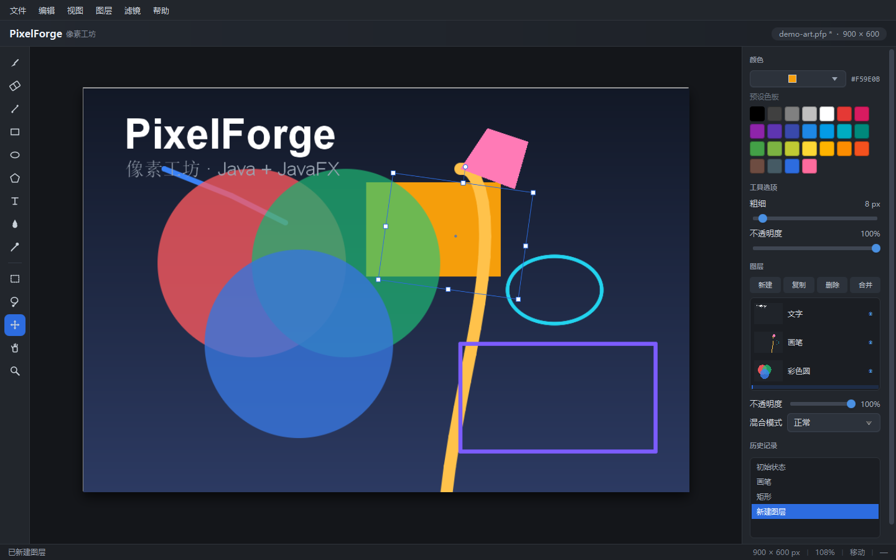

# PixelForge 像素工坊

一个用 **Java 17 + JavaFX 21** 从零实现的位图绘图 / 图像编辑软件，面向对象程序设计课程大作业。
除 JavaFX 运行时外不依赖任何第三方库：图层合成、像素绘制、选区变换、滤镜卷积、撤销重做
全部是本项目自己实现的代码。



> 想要立刻上手？先用「文件 → 打开」载入 `samples/示例作品.pfp` 看看效果。

## 快速开始

**环境要求**：Windows + JDK 17（JavaFX 已随项目放在 `lib/` 里，无需联网、无需 Maven）。

```
双击 run.bat      → 编译（首次）并启动程序
双击 build.bat    → 只编译，产物在 out\classes
双击 run-tests.bat → 运行自动化自检（渲染管线 + 工具链路）
```

如果你的 JDK 不在 `C:\Program Files\Microsoft\jdk-17.0.15.6-hotspot`，请编辑
`build.bat` / `run.bat` 顶部的 `JDK` 变量；若已设置好 `JAVA_HOME`，会自动使用它。

也可以用 Maven 构建（需要联网下载 JavaFX）：

```
mvn -f pom.xml clean package
```

## 功能一览

### 文件
- 新建画布（预设尺寸 / 自定义宽高 / 白色或透明背景）
- 打开工程文件 `.pfp`，或直接打开 PNG / JPEG / BMP / GIF 作为新文档
- 保存 / 另存为工程文件，导出 PNG（保留透明通道）、JPEG（可调压缩质量）
- 每 2 分钟自动保存草稿，异常退出后下次启动可一键恢复

### 绘制
- 画笔（圆头、抗锯齿、连续笔迹）、橡皮擦（擦成透明而非涂白）
- 直线、矩形、椭圆（按住 `Shift` 约束为 45° / 正方形 / 正圆），支持描边与填充
- 多边形（逐点单击定顶点、双击闭合）、文字（栅格化进图层）
- 油漆桶（扫描线洪水填充，带颜色容差）、取色器
- 颜色选择器 + 25 色预设色板，粗细 1~100px，不透明度 0~100%

### 选区与变换
- 矩形选框、自由套索选区
- 选区内容可抠出成"浮动内容"，自由平移、等比缩放、单轴缩放、旋转（`Shift` 吸附 15°）、
  `Alt` + 拖动角点做倾斜（扭曲），变换用仿射矩阵 + 双线性重采样
- 复制 / 剪切 / 粘贴 / 删除 / 全选 / 取消选择

### 图层
- 新建、复制、删除、向下合并、拖拽排序、双击重命名
- 显示 / 隐藏、不透明度、6 种混合模式（正常 / 正片叠底 / 滤色 / 叠加 / 变暗 / 变亮）
- 实时缩略图，与画布逐帧同步

### 视图
- 滚轮缩放、`空格` 拖拽平移、中键拖拽平移、抓手工具
- 适应窗口、实际大小、参考网格开关

### 滤镜
灰度、反色、高斯模糊、锐化、浮雕、边缘检测（Sobel）、马赛克、亮度/对比度
均作用于当前图层；存在选区时只处理选区内像素。

### 撤销
所有像素修改、图层增删改序、图层属性变化都可撤销 / 重做（最多 80 步，内存占用超限自动淘汰），
右侧历史面板列出全部步骤，点击任意一步可直接跳回该状态。

## 快捷键

| 分类 | 快捷键 |
| --- | --- |
| 文件 | `Ctrl+N` 新建 · `Ctrl+O` 打开 · `Ctrl+S` 保存 · `Ctrl+Shift+S` 另存为 · `Ctrl+Q` 退出 |
| 编辑 | `Ctrl+Z` 撤销 · `Ctrl+Y` 重做 · `Ctrl+X/C/V` 剪切/复制/粘贴 · `Delete` 删除 · `Ctrl+A` 全选 · `Ctrl+D` 取消选择 |
| 视图 | `Ctrl+=` 放大 · `Ctrl+-` 缩小 · `Ctrl+0` 适应窗口 · `Ctrl+1` 实际大小 · `Ctrl+'` 网格 |
| 图层 | `Ctrl+Shift+N` 新建图层 |
| 工具 | `B` 画笔 · `E` 橡皮 · `L` 直线 · `R` 矩形 · `O` 椭圆 · `P` 多边形 · `T` 文字 · `G` 油漆桶 · `I` 取色器 · `M` 选框 · `S` 套索 · `V` 移动 · `H` 抓手 · `Z` 缩放 |
| 其他 | 按住 `空格` 临时平移 · 绘制时按住 `Shift` 约束形状 · `Enter` 应用变换 · `Esc` 取消选择 |

## 目录结构

```
大作业/
├─ run.bat / build.bat / run-tests.bat   启动、编译、自检脚本
├─ pom.xml                              Maven 构建描述（可选）
├─ lib/                                 JavaFX 21 运行时
├─ screenshots/                         各阶段界面截图
└─ src/main/
   ├─ java/com/pixelforge/
   │  ├─ App.java              程序入口（全局异常兜底、主题装配）
   │  ├─ model/                Document、Layer、Selection、FloatingContent、BlendMode…
   │  ├─ render/               Compositor（图层合成）、PixelPainter（像素绘制）、filter/（滤镜）
   │  ├─ tool/                 14 个工具 + ToolManager + SelectionManager
   │  ├─ command/              Command 模式与 UndoManager
   │  ├─ io/                   ImageCodec、DocumentFile(.pfp)、DocumentIo
   │  ├─ ui/                   主窗口、画布视图、工具栏、颜色/图层/历史面板、图标
   │  ├─ dev/                  截图工具与两套自检程序
   │  └─ util/                 日志、颜色工具
   └─ resources/css/dark.css   深色主题样式表
```

## 设计要点

**分层架构**：`model`（纯数据，不依赖界面）→ `render`（像素算法）→ `tool`（交互）→
`ui`（JavaFX 界面）。工具只依赖 `ToolContext` 接口，因此可以脱离界面用脚本驱动测试。

**渲染管线**：每层用 `int[]`（0xAARRGGBB）存像素，`Compositor` 按
`aOut = aS + aD(1-aS)`、`cOut = (blend(cS,cD)·aS + cD·aD(1-aS)) / aOut`
自下而上合成，再一次性推给 JavaFX 的 `PixelWriter`。

**绘制算法**：画笔用"像素到线段距离"计算覆盖率实现抗锯齿；油漆桶是扫描线洪水填充；
形状描边复用线段绘制；文字用 AWT 渲染后按 alpha 合成，保证中英文都清晰。

**撤销**：一次笔画只记录被改动矩形区域的前后像素（`PixelEditCommand`），
而不是整层快照，因此几十步历史也只占几 MB；结构性操作（增删图层、调序、合并）用组合命令。

**选区变换**：选区像素被"抠"成 `FloatingContent`，用 `AffineTransform` 描述位置、缩放、
旋转、倾斜，提交时才双线性重采样写回图层，反复调整也不会累计失真。

## 工程文件格式（.pfp）

```
"PFP1" | version | width | height | layerCount
每层：名称(UTF-8) | 可见 | 不透明度 | 混合模式 | PNG 长度 | 图层 PNG 数据
```

图层像素用 PNG 编码，既保留完整透明通道，也避免了裸像素数组的体积。

## 自动化自检

`run-tests.bat` 会跑两套程序：

1. **PipelineTest** —— 图层合成、混合模式、透明度、工程文件往返、PNG/JPEG 导出、各滤镜数值
2. **ToolSmokeTest** —— 用合成鼠标事件驱动真实的工具与界面，验证画笔/橡皮/形状/填充/取色/
   选区/变换/图层/撤销重做各类行为

两个程序都会打印 `[PASS]` / `[FAIL]` 并给出通过率，退出码可用于集成。

## 已知限制

- 文字工具一次性栅格化，插入后不能再次编辑文字内容（可用撤销重做重新插入）
- 选区仅支持矩形与套索，暂不支持"添加到选区/从选区减去"
- 工程文件不保存选区与历史记录
